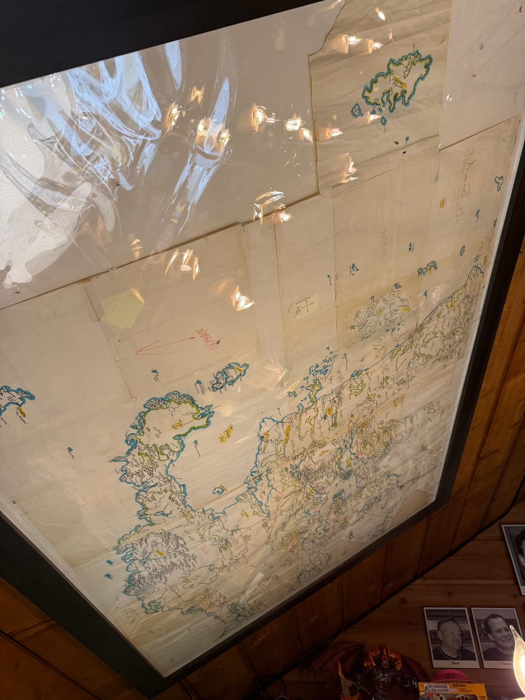
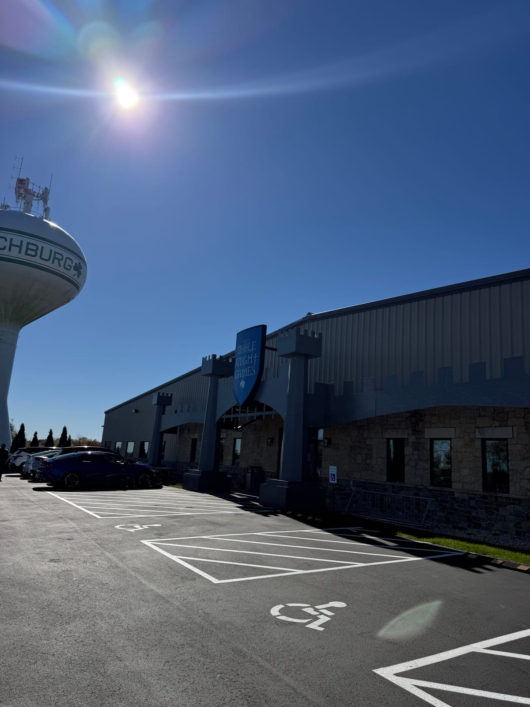
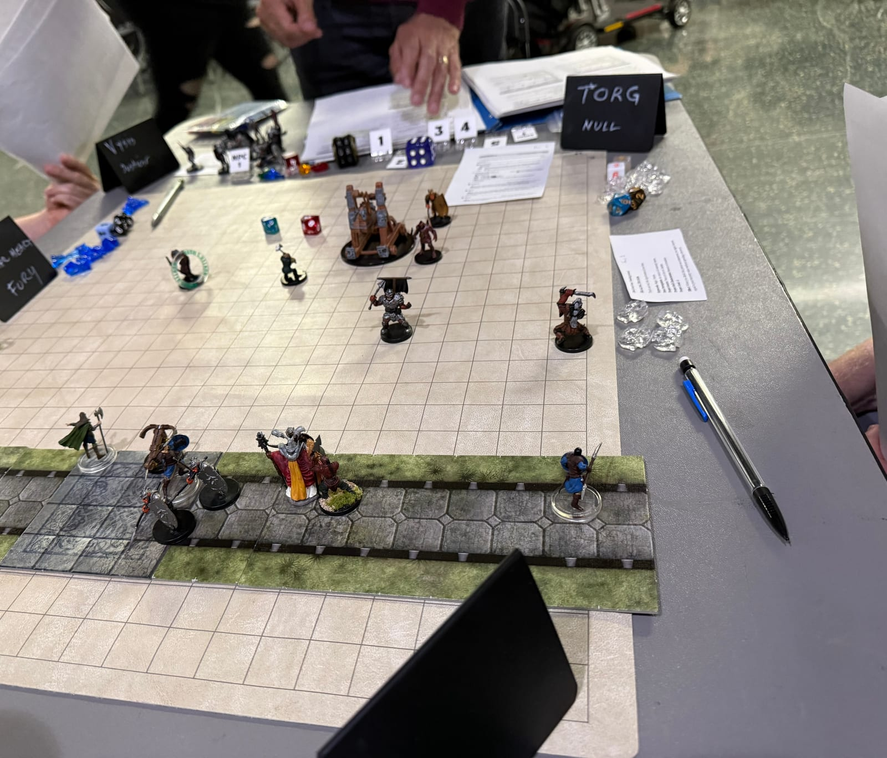
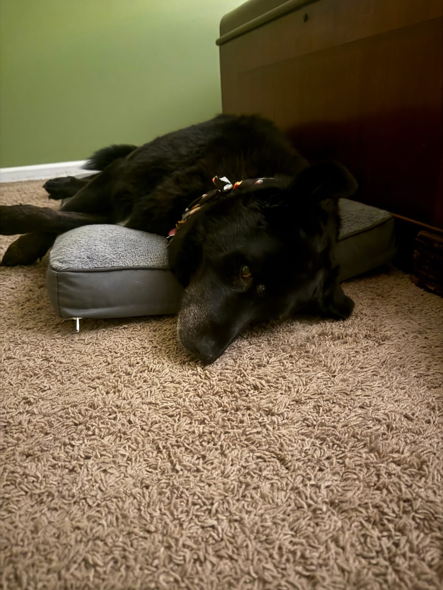

## Reflections

This is a summary of my experience at Gamehole Con 2026. I went for the first time last year, so this year I had a better idea of what I was doing. This is honestly my favorite TTRPG con right now — I mostly play non-DnD games, so I am hoping to pair it with Winter Fantasy to get my Baldman DnD goodness. Those two complement each other well if you want to play DnD and other games. I'll note I had a higher-level badge that made it easier to get into specials and allowed me to go to the reception. Now that I have seen the Gamehole, I will probably drop down to a VIG badge — it is worth it for early access to the specials, and Gamehole has a really good, fair system that lets VIGs likely get 2 of their 4 or 5 most wanted specials, which I think is worth the extra cost if you can afford it and play, rather than run, a lot of games.

I have nothing but great things to say about all of the GMs I had at the con. I don't know that I have ever been to a con and played with a better collection of GMs. They were incredible across the board.

## Wednesday

Wednesday night was the reception at the Free House Pub and getting to see the Gamehole. The food and reception were good, but the Gamehole (Gamehole Con founder Alex Kammer's personal play space) was a religious experience, including seeing Ed Greenwood's original map of the Forgotten Realms.

## Thursday

- *The Splintered Ward*, GM **Amanda Hamon**.

  I started Thursday with my first special, *The Splintered Ward*, with Amanda Hamon from Wizards. She ran an 11th-level DnD one-shot, and it was a great con game. She said she purposefully designed the pregens to be "fun" with showy powers and items — for example, my pally was packing a Holy Avenger. He also managed to land a 91-damage crit against the session's big bad (right after falling on his face with a 1), always fun. I'll admit this leans into my complaints with 5.5e — a group of 11th-level characters (exceptionally well equipped and well played) just wiped the floor with the adventure. 5e is bad about this too, but my early returns suggest 5.5e exacerbates it. But this was a con game, and meant to be over the top, so I may just be leaning into my own biases.

- *A Shot Across the Bow*, GM **Jeff** (The Firelight Brigade).

  This was a learn-to-play of *Pirate Borg*. I already knew most of the mechanics since I had just finished running a 10-session intro campaign with *Curse of Skeleton Point* from the core book, but this was nice because I had never learned ship combat. Jeff did a great job teaching the game, and much fun was had. I didn't die, but I did lose a limb!

- *Mork Billy*, GM **David Lewis** (the game's creator).

  I backed this game after last year's GHC, because I fell in love with Pirate Borg, and the idea of a hillbilly Borg sounded like a lot of fun to this Appalachian from eastern Kentucky. I had yet to do anything but browse the rulebook, and I told David I had high hopes (and expectations), especially with a northerner author! But he did a great job. It helped having a couple of folks from Mississippi to pick up some of the hillbilly jokes I was putting down. It was a rowdy, fun session with the whole party dying...twice. When a hillbilly sees a bunch of knobs, there is really nothing to do but turn them all the way up.

## Friday

- *Pirate Borg: The Dark Caribbean* playtest, designer/GM **Luke Stratton** (Limithron).

  I believe this was a playtest of one of the encounters from the Pirate Borg encounter map Kickstarter that recently closed. It was great to play with Luke, who of course knows how to make Pirate Borg sing. Disappointingly, the rest of my pirate group wanted to play it safe once we accomplished our mission and head home with their loot, but my pirate stayed in the dungeon out of a fascination with the Old Ones and got eaten alive. Mission accomplished.

- *Flooded Ruins* (2–4 PM, *Shadowdark*), GM **Marc** (Arcane Library).

  I played Shadowdark last year at GHC, and my review of that game was "Fantastic game of DnD. I don't feel like I played Shadowdark." That was not the case at all in this game — it felt like the full experience. Marc had 3D-printed torches that showed exactly how far you could see, and used timers to track them. It was probably the only time I have had fun worrying about light in a TTRPG. It was also a good adventure, and we escaped with just a few moments to spare. Marc did a great job giving me a proper introduction to Shadowdark.

- Mastering Dungeons live podcast taping, hosts **Teos Abadia** and **James Introcaso**.

  Of course I caught this, being a happy patron of Mastering Dungeons. It was interesting hearing about Crows, which I backed as I am a big fan of James' work. What I heard is that it is a bit like Shadowdark, but with more of a focus on building out a home base community. We had a gathering of Mastering Dungeons supporters afterwards, which has been a highlight both times I attended GHC.

## Saturday

- *Mistledale Muster* (9 AM–1 PM), GM **Eric Menge** (a RealmsBound preview).

  This is the level 1 introductory adventure from the new RealmsBound Dalelands book. I was lucky enough to snag a spot at this special at the con when one opened up. This was a good introductory DnD adventure, though it certainly felt like one. I got to play a Saurial (dino-men that don't speak and communicate via smell), and it was interesting to try to roleplay via scent. The table was full of big Realms fans, and Eric is amazing at effortlessly weaving in Realms lore in a way that never felt forced or know-it-all. Great game and a great preview for a book I will pick up day one.

- A visit to Noble Knight in the afternoon.

  I'm a longtime customer of Noble Knight, and Lou Anders (Lazy Wolf Studios, great teller of stories) joined me for my first in-person visit. I'll admit I was a little disappointed that the actual storefront, while large, isn't anything like as big as I imagined based on their stock. To get most things you have to go talk to someone at a kiosk, who will go pull it from the warehouse. So don't go expecting a warehouse full of RPG stuff you can browse. But do some planning ahead of time on the website (nobleknight.com) to figure out what you want. I picked up a copy of *Menzoberranzan* in decent shape, a set that has been at the top of my wish list for a while.

  

- *Draw Steel: Crack the Sun* playtest (7 PM, Open Gaming area), **Teos Abadia** as Director.

  Probably my favorite game of the con, thanks to an awesome Director and a great table of fellow Mastering Dungeons folks. It was my first time playing Draw Steel. Teos walked us through Negotiations (social encounters), Montages (think 4e skill challenges), and of course combat. I thought Negotiations were interesting in that you are trying to find NPC motivations while avoiding pitfalls. It worked great at the table, but I wonder how it would play out after the 50th Negotiation in a campaign. Montages were more interesting than skill challenges as they have different difficulty levels for different stated tasks, so my gut is they would feel more replayable than classic skill challenges, since the party needs to plan who will do what to increase the chances of success. And finally, my tongue-in-cheek review of combat is "4e but good." 4e was the only edition I never finished a campaign in, because all the classes felt too samey, and the characters pretty quickly became invincible and able to counter anything a DM could throw at them. This was only one level, but all the characters were fun and differentiated, and had a variety of things to do. I played a Conduit, and I could heal and do damage effectively and always had a lot of tactical choices. The final encounter of the game put a bunch of monsters between you and an objective, and one player quickly and correctly called out that the monsters were just a distraction and we had to deal with the objective. And then we all proceeded to hammer on the big demon thing instead of the objective. But hey, I did extra holy damage to it! Never mind that I had all the skills to solve the objective! We all laughed about this quite a bit, and we kept right on not doing the objective, with Teos regularly reminding us, "Hey, remember you do extra holy damage to this big bag of hit points!" We prevailed in the end, but only by passing several checks in a row after killing all the monsters with no time left. As for Draw Steel, I will probably run *Crack the Sun* when it comes out. I like the resource mechanics and the classes, and I am really curious how balance scales as you advance levels. It feels like a great tactical game without some of the pitfalls of 4e, and I am a bit burnt out on DnD with 5.5e, so I think it will be a fun change of pace.

  

## Sunday

- *The Last Caravan: Search for the Greenship*, GM **Graham Ward** (The Last Caravan designer and developer).

  A great end to the con. I read The Last Caravan shortly after it came out, and I was excited to try it. I was a little hesitant to lean in and play a Good Boi Imprint (I usually pick the card about avoiding hurting pets in the Deck of Player Safety, shout out Tom Nelson). The fact that negative effects lead to fear, not damage, in this Imprint made me give it a try, and even play my own dog, Kona. We also had a playtest cat Imprint at the table, so the other two players had to do a lot of heavy lifting in some of the encounters! But it was a great time, and Graham did a great job teaching the game. It was probably the most unique-feeling system I played over the weekend, and another I want to run soon. Kona was exhausted after her adventure!

  

## Links to Products Mentioned in This Post

- [Pirate Borg](https://shop.limithron.com/collections/pirate-borg) (Limithron)
- [Mork Billy](https://morkbilly.com/)
- [Shadowdark](https://www.thearcanelibrary.com/collections/shadowdark-rpg) (The Arcane Library)
- [Mastering Dungeons](https://www.patreon.com/cw/MasteringDnD) (Patreon)
- [Crows: Fortune or Death](https://mcdm.gg/crows-rpg) (MCDM, pre-order)
- [Noble Knight Games](https://www.nobleknight.com/)
- [Lazy Wolf Studios](https://www.lazywolfstudios.com/)
- [Draw Steel](https://shop.mcdmproductions.com/collections/getting-started-with-draw-steel) (MCDM)
- [Draw Steel: Crack the Sun](https://crack-the-sun.backerkit.com/hosted_preorders) (MCDM, pre-order)
- [The Last Caravan](https://www.myth.works/products/the-last-caravan-core-rulebook) (Mythworks)
- [Deck of Player Safety](https://www.exaltedfuneral.com/products/deck-of-player-safety)
